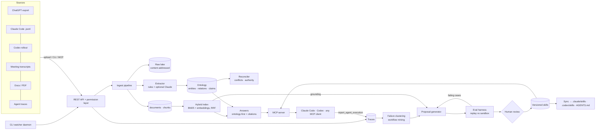

# Architecture



## Design principles

1. **Raw first, derive later.** Every upload is stored byte-exact (`data/lake/raw/<yyyy-mm>/<sha256>.<ext>`) before parsing. Normalized text, chunks, entities and claims are derived and can be rebuilt as parsers and models improve. No lossy summarization upfront.
2. **Facts have provenance.** The ontology stores *claims* (entity, predicate, value, source document, speaker, observed-at, authority, confidence), not bare attribute values. An entity's attribute is a *view* over its claims, so we can always answer "who said this, where, and is it still true?"
3. **Disagreement is a first-class state.** For single-valued predicates, conflicting claims open a conflict with a scored proposal and a human-readable rationale. Approval marks alternatives `superseded`. Nothing is deleted, and history is kept.
4. **Permissions before ranking.** Search filters to the principal's visible document set *before* scoring, so restricted content can't leak through snippets, related entities, counts or ontology answers. Agents get `user access ∩ key policy`.
5. **Improvements must be proven.** A skill proposal can't be meaningfully approved without an evaluation that replays the actual failures. The eval can also send a proposal back for refinement.
6. **Offline-capable, Claude-enhanced.** Every AI step has a deterministic implementation, so the system is reproducible and testable. Claude upgrades quality where it matters (extraction recall, answer prose, proposal writing, skill→policy compilation).

## Ingestion

`ingest/parsers.ts` detects the format from structure (not just extension):

| Format | Detection | Preserved |
|---|---|---|
| ChatGPT `conversations.json` | array with `mapping` | active branch (walks `current_node` → root), models, discarded branch count |
| Claude Code session | JSONL with `type: user/assistant` + `message` | text, `tool_use` / `tool_result` (errors flagged), tokens, model, cwd, git branch, session summary |
| Codex rollout | JSONL with `session_meta` / `response_item` | messages, `function_call` + outputs, exit codes, cwd, model |
| Agent traces | JSON with `task` + `status` | full step timeline + fault metadata → also written to `traces` |
| Transcripts | WebVTT or ≥35% `Speaker: text` lines | header metadata (date, type, attendees, project), per-turn speakers |
| Docs | Markdown/TXT/JSON/PDF (`unpdf`) | frontmatter → metadata, headings |

`ingest/pipeline.ts`: raw store → parse → **dedupe** (normalized SHA-256 for exact; 5-word-shingle Jaccard ≥ 0.85 for near-duplicates, e.g. re-exports) → chunk (~110 words, speaker-preserving) → extract → index → traces. Each import records its stage and stats. Duplicates are stored as pointers (`duplicate_of`) so the history shows what was blocked.

## Ontology and reconciliation

`engine/extract.ts` combines a gazetteer (known entities + aliases, so "Maya" resolves to "Maya Chen") with patterns for projects, customers, technologies, issues, decisions, tasks, and **claims** (deadline/owner/status with date normalization, hedging vs explicit-change detection, per-line speaker attribution). When Claude is configured, a structured-output pass (`messages.parse` + zod schema) is merged on top.

`engine/ontology.ts` scores conflicting claims:

```
score = 0.4 · authority + 0.4 · recency + 0.2 · explicitness
authority = source-kind weight (admin-tunable) + planning-meeting bonus + speaker-is-owner bonus
```

The rationale is generated from the same factors ("stated by Priya Patel (project owner) 18 days later in a planning meeting, using explicit change language"). After a human resolves a conflict, only claims that arrive *later* can reopen it.

## Retrieval

`engine/search.ts` keeps an in-memory index (rebuilt at boot in milliseconds, updated incrementally on ingest):

- **Keyword:** BM25 (k1 = 1.2, b = 0.75) over normalized tokens with a small concept map (fail/error/outage → `fail`; launch/due/ship → `deadline`).
- **Semantic:** 512-d signed feature-hashing of unigrams, bigrams and character 4-grams. It's dependency-free and lives behind `embed()`, so swapping in a hosted embedding model is a one-function change.
- **Fusion:** Reciprocal Rank Fusion; filters for project, source and date range.
- **Answers:** diversified top chunks (max 2 per document) + neighbour-chunk expansion for why/how questions. **Ontology facts are injected first** when the question names an entity and a predicate. Claude writes the answer from numbered sources when configured. Offline, an extractive answerer selects cause/fix/fact sentences using IDF-weighted coverage and anchor terms (proper nouns in the question must appear in the evidence, which prevents confident filler).

## Self-improving skills

| Step | Implementation |
|---|---|
| Detect | `traces.ts` normalizes error messages into signatures (`<n>`, `<url>`, `<path>`, `<name>`) and clusters by (skill, signature); `repeatedWorkflows()` mines tool-call n-grams in unskilled successful traces |
| Propose | `skills.ts` uses Claude, or a remediation library keyed by failure type, to write a minimal SKILL.md edit, attaching evidence traces and related org knowledge |
| Evaluate | `eval/harness.ts` compiles each skill version into an execution policy (timeouts, retries, backoff, retry-on, Retry-After, idempotency), then an executor performs real HTTP calls against `eval/mockApi.ts`. That sandbox reproduces each historical failure's fault (latency spike, 503, 429, commit-then-hang, invalid card) with per-run server state, which is how duplicate charges are detected |
| Refine | failing eval cases → remediation + knowledge search (e.g. the Engineering Handbook's idempotency rule) → revised proposal |
| Approve | admin-only; creates an immutable version, activates it, syncs files, writes the audit log |
| Measure | live executions recorded as normal traces; success-by-version excludes eval runs |

The harness covers skills whose failures are reproducible over HTTP. Other skill families need their own replay environment (an ephemeral Postgres for `database-migration`, a test runner for code skills). The UI and API say so instead of faking a score.

## Permissions

```
visible(doc) = human_rule(doc) ∧ agent_rule(doc)
human_rule: private → owner only; team → team members (+admins); restricted project → project team (+admins)
agent_rule: doc.visibility ≤ key.max_visibility; restricted projects need an elevated key; project allow-list
actions:    role ∈ rule.roles ∧ (agent ⇒ scope ∈ key.scopes)
```

Entities, relations, claims, conflicts and ontology answers are filtered through the visible document set. Restricted projects return "Unknown project" rather than "Forbidden", so their existence isn't leaked. Every denial is audited.

## Enterprise path (not built)

- **Self-hosted / on-prem:** single container today (`Dockerfile`). Production splits into API, ingest workers, and Postgres + object storage, with the same code boundaries.
- **Control plane:** org/tenant provisioning, key rotation, retention policies per source, SSO/SCIM, per-tenant model configuration.
- **SOC 2:** the audit log, least-privilege agent keys and raw-data lineage are the foundations; next come encryption at rest, retention/deletion workflows, access reviews and change management.
